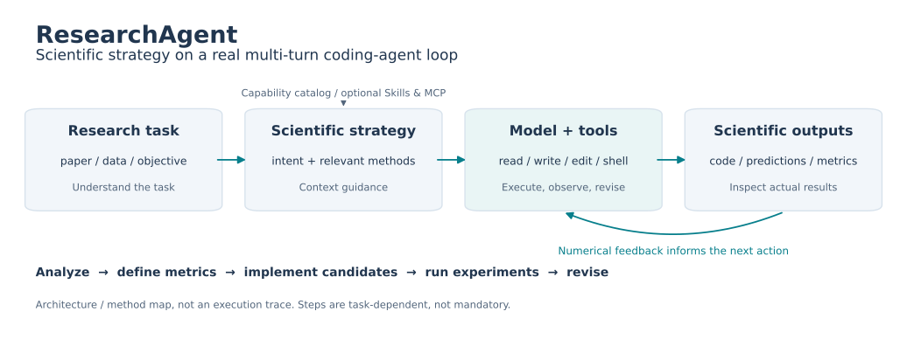
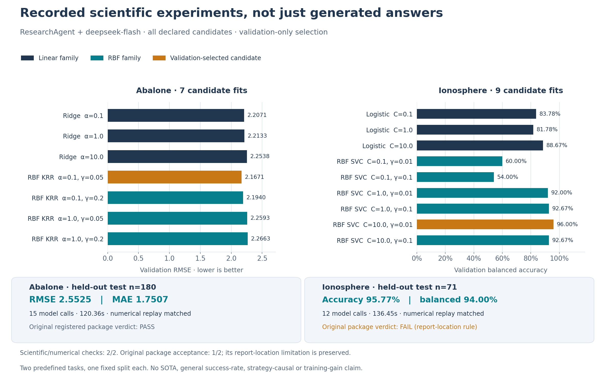
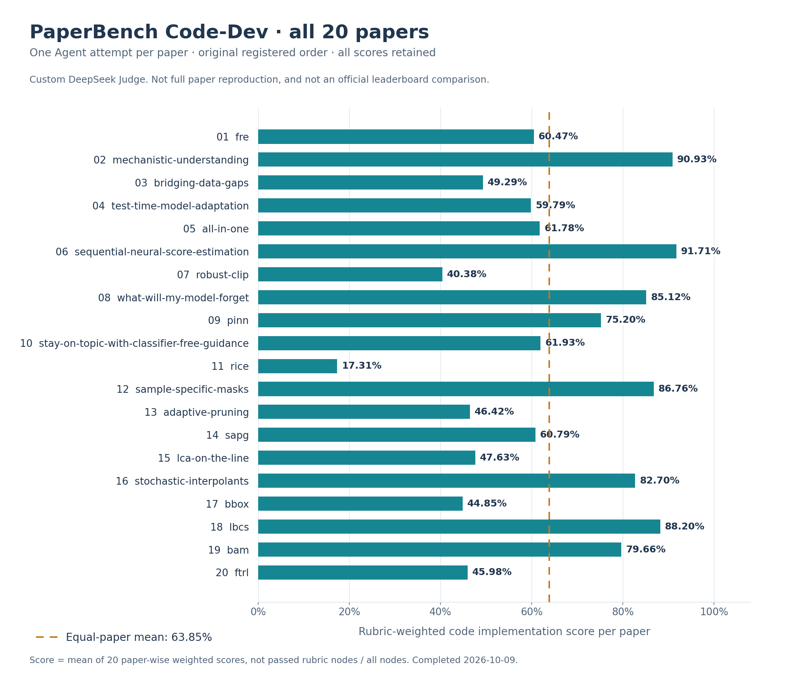

# ResearchAgent

**面向论文方法实现、数据分析和实验迭代的科研任务智能体。**

ResearchAgent 在通用模型—工具执行底座上，根据用户目标及论文、数据、实验信号选择工作策略，将方法指导、推荐工具和验证要求组织到上下文，再通过实际文件操作与命令执行推进任务。

科研策略是一种按场景使用的工作方式，不是要求每个任务走完固定流水线，也不是模型内部专属推理算法。这个最小发行包只包含真实 CLI 执行路径，不需要启动网页。

## 核心思路与实现

不是只回答“应该怎样做”，而是将科研方法指导接入真实的模型—工具循环：

**需求与数据分析 → 明确指标 → 生成与比较方案 → 编写功能代码 → 执行实验 → 根据数值反馈修正。**



*这张图表达实现关系与工作方法，不是成功轨迹截图；步骤按任务选择，不是固定必经流水线，也不声称模型内部启用了专属推理算法。*

| 能力职责 | 具体实现 | 实际入口 |
|---|---|---|
| 任务意图与科研策略 | 从用户目标、材料与任务信号选择工作策略，将理由、相关能力和方法要求组织到上下文 | [`decision.ts`](src/core/decision.ts)、[`sessionRuntime.ts`](src/core/sessionRuntime.ts) |
| 科研方法与能力组织 | 数据分析、论文实现、实验运行等能力目录；按需发现工作区 Skills 和接入 MCP 工具 | [`skills.ts`](src/core/skills.ts)、[`capabilityRuntime.ts`](src/core/capabilityRuntime.ts)、[`mcpClient.ts`](src/core/mcpClient.ts) |
| 代码—实验反馈闭环 | 流式工具参数拼接，实际读取、检索、编辑、写文件与执行命令；将结果回填给模型继续行动 | [`chatStreamRuntime.ts`](src/core/chatStreamRuntime.ts)、[`agenticTools.ts`](src/core/agenticTools.ts) |

识别策略是规则/启发式，不是训练过的意图分类模型；能力目录也不等于全部科研方法已完整 Skill 化。会话、权限和运行记录只是支撑，主要能力仍是具体方案、功能代码与真实实验结果。

## 真实 Agent 能力与结果

以下来自**既有冻结版本的真实模型运行**，不是 `npm test` 的假模型响应。图表于2026-10-13整理，没有重跑 Agent、修改任务或挑选更高分。

| 任务 / 评测 | Agent 实际执行的工作 | 已观察结果 | 条件与范围 |
|---|---|---|---|
| PaperBench Code-Dev 官方 `all.txt` 全部20篇 | 每篇一次论文方法代码生成；统一对固定提交评分 | **平均加权代码实现分63.85%，20/20评分完成** | DeepSeek自定义Judge；不是完整论文训练复现成功率，也不能直接与官方报告排名 |
| Abalone 回归 | 编写预处理、Ridge / RBF核岭代码，执行7个固定候选；用验证集选参，导出测试预测与指标 | 测试 **RMSE 2.5525 / MAE 1.7507**；独立数值重跑一致 | 600/180/180训练/验证/测试；单次固定划分 |
| Ionosphere 分类 | 编写Logistic / RBF SVC代码，执行9个固定候选；用验证集选参，导出测试预测与指标 | 测试 **Accuracy 95.77% / Balanced Accuracy 94.00%**；独立数值重跑一致 | 210/70/71训练/验证/测试；单次固定划分 |

**两个科学案例的科学过程与独立数值检查均正确，但原始整包验收仍是1/2。** Ionosphere有任务未声明的报告根目录约束导致验收假阴性；保留原判定，不把它改写为原协议2/2或通用任务成功率。

### 从方案到实际实验



图中柱形是 Agent 程序实际输出的**验证集**结果，橙色表示按任务预先声明的规则选出的候选；下方是该候选的**测试集**指标。没有用测试分数选参，也没有从多次运行中择优。这说明 Agent 在这些条件下完成过科学代码与实验，不说明它发明了新算法或取得SOTA。

以 Abalone 为例，已记录的前六次模型请求包含以下实际动作，而非预填流程：

| 模型请求 | 真实工具动作 | 任务推进 |
|---|---|---|
| #1–#3 | `cog_read` / `cog_bash` | 读取任务规范、CSV与数据类型，理解预处理和划分要求 |
| #4 | `cog_todo_write` | 组织实现、实验与结果检查计划 |
| #5 | `cog_write` | 生成 `run_experiment.py` |
| #6 | `cog_experiment_run` | 执行程序，实际得到候选比较、预测和指标 |

[科学案例数值与工具事件摘要](docs/evaluation/d1-scientific-execution-summary.json)包含全部候选、所选参数、原始判定与源码摘要；不包含原始数据、模型对话或私有凭据。完整结果范围见 [EVALUATION.md](docs/EVALUATION.md)。

### PaperBench：完整20篇，而不是挑选高分案例



**63.85% = 每篇按rubric权重计算后，再对20篇等权平均**，不是“通过节点总数 / 全部节点数”。按原注册顺序展示全部论文，保留低分；评分于2026-10-09完成。补评只处理独立Judge的超时/断开，未重跑Agent或修改提交，不择高分。

[20篇机读结果](docs/evaluation/paperbench-code-dev-all20-summary.json) · [逐篇表格与评测设置](docs/EVALUATION.md) · [原评测代码](evaluation/paperbench_code_dev/)

**DeepSeek自定义Judge不是原报告Judge配置。** 此分数衡量代码开发要求，不是完整训练/推理复现成功率，不能据此宣称超过官方模型或科研策略的因果收益。

### 尚未建立的训练与系统收益

| 固定对照实验 | 完整任务结果 | 观察与决定 |
|---|---|---|
| D2：原始7B / 助手动作轨迹LoRA SFT | **0/4 → 0/4** | 没有功能源码或科学产物收益；当前配方 `STOP_NO_GAIN` |
| D3：同一原始7B，原生系统 / mini-SWE-agent | **0/2 / 0/2**；源码产出 **0/2 / 2/2** | minimal系统改变了行动行为，但科学程序理解与修复仍失败，不能宣称完成率提升 |

这些是固定7B学生的诊断，不等于生产模型退步或所有SFT无效。**算法训练改善完整Agent能力的研究目标尚未达成。** 原始源码与策略保持冻结；代码与范围见 [实验说明](experiments/README.md)。

<details>
<summary>图表的数据来源与生成方式</summary>

图表仅从仓库中的两个精简JSON生成：全20篇PaperBench分数，以及D1既有科学程序/独立数值重跑摘要。架构图与结果图明确区分；没有新模型请求、训练或benchmark运行。图内使用英文保证跨平台字体清晰，中文解释与真实工具编号在正文。

有Python与Matplotlib时可以重新生成：

```powershell
python scripts/render_readme_figures.py
```

此脚本只读取固定结果并写入 `docs/assets/`，不是Agent执行入口，也不是实验重跑。没有增加CLI安装依赖。

</details>

## 安装与启动

要求 Node.js 22 或更高版本、npm，以及能够访问 npm registry。代码执行涉及 Python/训练工具时，还需要在你的任务环境中自行安装对应依赖；这些不是 Agent 本身的安装要求。

```powershell
npm ci
npm run check
npm test
Copy-Item .env.example .env
```

编辑本地 `.env`，填写自己的 OpenAI-compatible endpoint 和 API Key。使用支持流式 tool calling 的模型：

```dotenv
CLAW_MODEL_BASE_URL=https://your-openai-compatible-endpoint.example/v1
CLAW_MODEL_API_KEY=replace-with-your-api-key
```

**不要提交真实密钥。** `default:MODEL_ID` 的模型名应替换为你的服务实际支持的名称。

```powershell
# 连续交互
npm run agent -- --workspace ./examples/research-task --model "default:MODEL_ID"

# 一次任务后退出
npm run agent -- --workspace ./examples/research-task --model "default:MODEL_ID" --once "读取 task.md 和 data.csv，编写汇总程序并执行，输出按组统计结果；说明实现和未运行的部分。"

# 使用你已有的科研工作区和附件
npm run agent -- --workspace "E:\my-research-task" --model "default:MODEL_ID" --attach "E:\my-research-task\paper.md" --once "理解所附论文方法，组织实现方案，在当前工作区编写功能代码，并运行小规模验证。"

# 查看本地会话 / 工作区
npm run cli -- sessions
npm run cli -- workspaces
```

启动时在**发行包根目录**运行这些命令，以便读取该目录下的 `.env`。Shell 工具会执行真实命令，请使用允许 Agent 修改的工作区。模型用量会产生服务费用；本包没有内置全账户预算限制，原评测外层的费用账本也不在本包中。

常见交互命令包括 `/help`、`/status`、`/model`、`/mode auto`、`/mode plan`、`/sessions`、`/workspace` 和 `/compact`。`/quota` 依赖原网页服务，不属于此 CLI 最小包的使用路径。

## 最小示例

`examples/research-task/` 是一个小型 CSV 数据处理任务，包含输入材料和固定检查脚本。先让 Agent 完成任务，再在该工作区独立运行：

```powershell
node verify.mjs
```

这只是易运行的使用示例，不是外部 benchmark，不预填模型任务成功率。`npm test` 则采用离线假模型响应确认 CLI、流式工具参数和真实文件写入能接通，不调用付费模型，不算科研任务成绩。

## 文件结构

```text
src/cli.ts                 实际命令行入口
src/core/                  CLI 需要的模型、工具、策略、上下文和扩展模块
config/                    能力配置
examples/research-task/     最小任务输入与独立检查
scripts/smoke.mjs           不调用真实模型的启动 / 工具调用冒烟检查
docs/ARCHITECTURE.md        实际入口与关键实现映射
docs/EVALUATION.md          当前结果范围、20篇分数和限制
docs/evaluation/           可机读的精简结果与真实科学案例
docs/assets/               架构图、全量分数图与真实候选实验图
scripts/render_readme_figures.py  从固定JSON生成文档图表
experiments/               冻结的D2/D3研究脚本与协议
evaluation/                既有PaperBench评测源代码
docs/source-manifest.json  复制源码的版本与摘要
.env.example               无真实凭据的配置模板
```

## 来源与贡献边界

ResearchAgent 是此最小发行版的项目名称；CLI 源码从被评测的本地实现按依赖闭包原样复制，内部标识、工具名称和配置前缀仍保留 `COG-CLAW` / `cog_*` / `CLAW_*`。这不是另一个新模型或重写后的新实验系统。

本包不含嵌入式商业引擎镜像、前端、私有凭据或原始历史任务产物；上述图表只包含精简数值与工具事件摘要。源码中的风格参考不应被写成“完整官方开源内核”。本次发布未额外授予新的开源许可；npm 依赖遵循各自许可。
